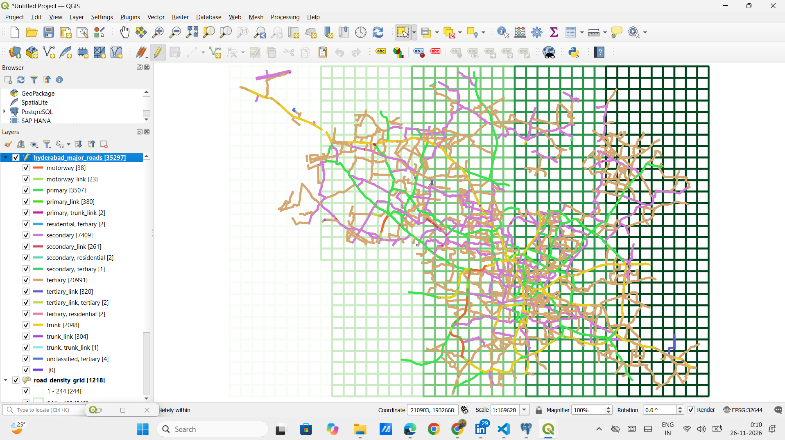

# Hyderabad Road Network Analysis

## Project Overview
A Geospatial Data Engineering project focused on analysing Hyderabad's urban road network using OpenStreetMap data.

## Objectives
- Extract Hyderabad's road network.
- Clean and validate spatial data.
- Classify roads based on road types.
- Store and analyse spatial data using PostgreSQL and PostGIS.
- Perform road density analysis using a 1 km grid.
- Visualise results using QGIS.

## Technologies Used
- Python
- Pandas
- GeoPandas
- Shapely
- OpenStreetMap
- PostgreSQL
- PostGIS
- QGIS

## Project Statistics
- Total road segments: 359,510
- Major road segments: 35,297
- Road density grid cells: 1,218
- Project CRS: EPSG:32644

## Workflow
1. Road network extraction using OSMnx.
2. Spatial data cleaning using GeoPandas.
3. Road classification and length calculation.
4. Data storage in PostgreSQL/PostGIS.
5. Spatial queries and road density analysis.
6. Map creation and visualisation in QGIS.

## Repository Structure
- notebooks: Python analysis notebooks
- output: Analysis reports and exported map
- sql: PostGIS spatial queries
- screenshots: Project visualisations

## Final Map

The map presents Hyderabad's major road network and road density analysis using QGIS.

## Data Source
© OpenStreetMap contributors.

## Author
Geospatial Data Engineering Portfolio Project.
